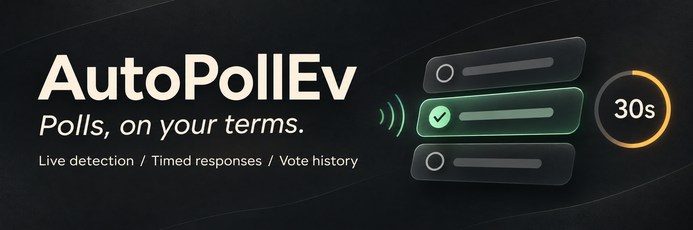
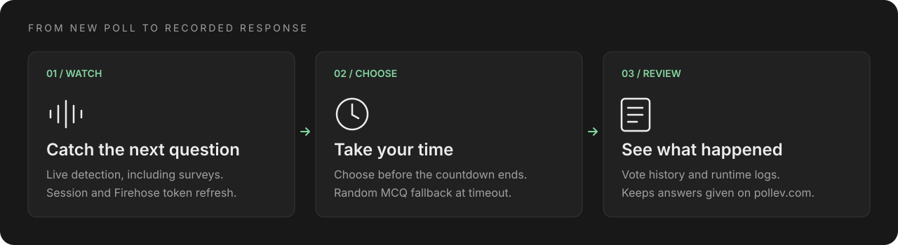

# AutoPollEv

A compact desktop app that watches a [Poll Everywhere](https://pollev.com/)
presenter, alerts you to new questions, and lets you choose an answer before a
countdown ends. For multiple-choice questions, it picks a random option if you
do not respond in time.

[](https://github.com/SamoyedCodes/autopollev/releases/latest)
[](https://github.com/SamoyedCodes/autopollev/actions/workflows/release.yml)
[](LICENSE)

**[Download for Windows](https://github.com/SamoyedCodes/autopollev/releases/latest)**
· [Run from source](#run-from-source)
· [How it works](docs/TECHNICAL_REPORT.md)

> **Alpha:** multiple-choice voting works for standalone polls and surveys.
> Free-text questions and word clouds are detected, but **text submission is
> disabled** until its endpoint and payload are verified. Answer those on
> pollev.com. The app does not solve questions or check correctness.

## Features



- **Live detection.** Watches the presenter's Firehose feed, refreshes expired
  Firehose tokens, and handles open survey questions one at a time.
- **Your choice first.** A popup shows the question, answer buttons, and a
  countdown. The default timeout is 30 seconds; closing the popup also uses
  the random multiple-choice fallback.
- **Keeps manual answers.** Checks your existing response before submitting, so
  an answer given on pollev.com while the popup is open is kept and shown as
  **Answered** in history.
- **Desktop controls.** Dark Tkinter interface with an editable presenter host,
  session identity, monitoring status, resizable vote history, and a log panel
  you can show or hide. Desktop notifications work on macOS and Windows.
- **Browser login.** Sign in through the built-in Chromium window. The app saves
  the session cookie and attempts to refresh expired sessions automatically.
- **Local history.** Run logs and JSONL vote history stay on your computer;
  terminal mode can print past responses and statistics.

## Quick start on Windows

1. Download `AutoPollEv-windows.zip` from the
   [latest release](https://github.com/SamoyedCodes/autopollev/releases/latest).
2. Extract the whole zip into a writable folder and run `AutoPollEv.exe`.
   Chromium is included; Python is not required.
3. Click **Log in** and complete your Poll Everywhere sign-in in the browser
   window. Check the account shown beside **Session** before starting.
4. Enter the presenter ID in **Host** and click **Save**. For
   `https://pollev.com/your-presenter-id`, enter `your-presenter-id`.
5. Click **Start**. Choose an option when a poll appears, or let the countdown
   select a random multiple-choice answer.

The app writes `config.json`, `logs/`, and `.pw_profile/` beside the executable.
Keep the extracted folder together. The Windows build opens the GUI; terminal
modes are available when running from source.

The executable is unsigned, so Windows may show a security warning or an
antivirus detection. Review the source and build provenance before running it.
Suspected false positives can be submitted to
[Microsoft for review](https://www.microsoft.com/en-us/wdsi/filesubmission).

## Run from source

Use Python 3.11 or newer with Tk. A Conda or Miniforge environment includes Tk:

```bash
git clone https://github.com/SamoyedCodes/autopollev.git
cd autopollev
conda create -n pollev python=3.11
conda activate pollev
pip install -r requirements.txt
playwright install chromium
python main.py
```

For a plain virtual environment, use
`python3 -m venv .venv && source .venv/bin/activate`, then run the same dependency
and browser install commands. With Homebrew Python, install the matching Tk
package, such as `brew install python-tk@3.11` for Python 3.11.

The first run creates `config.json`. In the GUI, click **Log in**, complete the
browser sign-in, check the captured account, save your presenter ID, and click
**Start**. For a terminal-only login, use `python main.py --login`.

### Commands

| Command | What it does |
|---|---|
| `python main.py` | Launch the GUI (default) |
| `python main.py --gui` | Launch the GUI explicitly |
| `python main.py --login` | Capture the session cookie and exit |
| `python main.py --cli` | Ask for an answer in the terminal, with a timeout |
| `python main.py --auto` | Choose random multiple-choice answers without prompting |
| `python main.py --history` | Print vote history and statistics, then exit |

Add `--config PATH` to use a different config file.

### Configuration

`config.json` is created on first run and can also be edited by hand:

```json
{
  "host": "your-presenter-id",
  "cookies": {
    "polleverywhere_session_id": "<captured automatically>"
  },
  "poll_interval": 5,
  "answer_delay": 2,
  "user_choice_timeout": 30,
  "log_dir": "logs"
}
```

| Field | Purpose |
|---|---|
| `host` | Presenter ID, from the part after `pollev.com/` |
| `cookies.polleverywhere_session_id` | Session cookie saved by the login window |
| `poll_interval` | Delay between monitoring checks, in seconds |
| `answer_delay` | Delay before a vote, in seconds |
| `user_choice_timeout` | Time to answer before the fallback, in seconds |
| `log_dir` | Run logs and vote history directory |

Saving a new host while monitoring restarts the monitor with that presenter.
The login profile stays in `.pw_profile/` so session refresh can reuse it.
`config.json` and `.pw_profile/` contain authentication data; do not share them
or commit them to Git. Both are ignored by this repository.

### Supported questions

| Question type | Current behavior |
|---|---|
| Standalone multiple choice | Manual choice or random fallback; submits the response |
| Multiple choice inside a survey | Handles open, unanswered questions one at a time |
| Free text / word cloud, standalone or in surveys | Detects the question and offers text input, but blocks submission; answer on pollev.com |
| Other formats, such as ranking | Skips with a log message; answer on pollev.com |

For text input, timeout or closing the popup selects exactly `Not sure`, even
if an unfinished draft exists. `--auto` selects the same fallback. These
attempts are logged as blocked, with no option ID; no text request is sent.

## Development

```text
main.py                   GUI / CLI entry point
autopollev/
  config.py               configuration and validation
  auth.py                 session checks and account identity
  session_capture.py      Playwright browser login
  monitor.py              Firehose and survey detection
  voter.py                response submission and manual-answer checks
  gui.py                  Tkinter interface and question popup
  notifier.py             desktop notifications
  logger.py               run logs and JSONL history
  endpoints.py            Poll Everywhere URLs
  i18n.py                 user-facing strings
docs/TECHNICAL_REPORT.md   detection design and troubleshooting
tests/                    unittest suite and GUI smoke check
```

Run checks in the `pollev` environment:

```bash
conda activate pollev
python -m unittest discover -s tests -p 'test_*.py'
python tests/gui_smoke.py
```

Use `python tests/gui_smoke.py --preview` to inspect the GUI with sample data.
The [technical report](docs/TECHNICAL_REPORT.md) explains the detection flow and
its original failure modes.

### Build a Windows release

The [release workflow](.github/workflows/release.yml) runs tests, bundles the
app and Chromium with PyInstaller, and attaches `AutoPollEv-windows.zip` to a
GitHub release when a `v*` tag is pushed. It also prints the executable's SHA-256
checksum in the build log.

After syncing `autopollev.__version__` and `windows_version.txt`, tag the
release commit with a new, unused semantic version and push it:

```bash
git tag -a vX.Y.Z -m "Release vX.Y.Z"
git push origin main vX.Y.Z
```

Replace `X.Y.Z` with the next version. Tagged builds stamp that version into the
Windows executable. **Run workflow** on the Actions page produces a test
artifact without publishing a release.

## License and use

[MIT License](LICENSE). This is an independent learning project, unaffiliated
with Poll Everywhere. Check the site's terms and your institution's rules
before using it. A recorded response does not guarantee participation credit;
that depends on your account, registration, and the presenter's settings.
